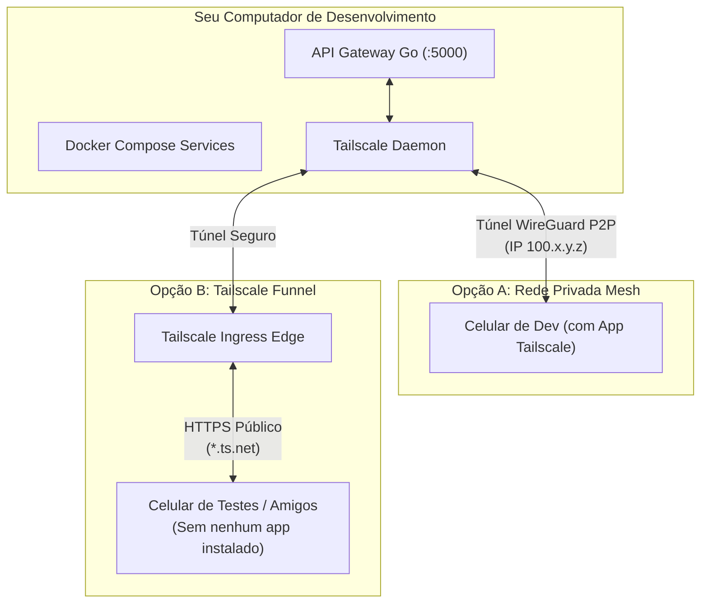

# Guia de Testes Remotos e Mobile sem IP Público (Bypass de CGNAT)

Este documento orienta como executar e testar o ecossistema do **Manhua Manager Pro** (Backend Go, Web Angular e Mobile Flutter) em dispositivos móveis físicos (Android/iOS) e estações de teste sem necessidade de possuir IP público dedicado ou publicar a aplicação na nuvem comercial.

---

## 1. O Desafio: Falta de IP Público, CGNAT e Cleartext Traffic

Na maioria das conexões residenciais modernas de banda larga e fibra óptica, os provedores de internet (ISPs) utilizam **CGNAT (Carrier-Grade NAT / RFC 6598)**. Sob CGNAT:
1. Sua máquina compartilha um endereço IPv4 público coletivo com centenas de outros clientes.
2. O tradicional redirecionamento de portas (*port forwarding*) no roteador da sua casa torna-se inoperante, pois as conexões externas de entrada não chegam ao seu roteador.
3. **Restrição Mandatória do Mobile:** Tanto o Android (a partir da API 28 / Android 9 via *Network Security Config*) quanto o iOS (*App Transport Security - ATS*) bloqueiam requisições HTTP puro (*cleartext HTTP*) por padrão. Qualquer conexão de teste móvel em rede externa exige **TLS/HTTPS com certificado válido** ou um canal encapsulado em VPN.

---

## 2. Solução Recomendada: Tailscale

> [!TIP]
> **RECOMENDAÇÃO OFICIAL:** O **Tailscale** é a solução padrão recomendada para o desenvolvimento do Manhua Manager Pro. Ele resolve completamente o CGNAT utilizando a tecnologia WireGuard com NAT Traversal inteligente (STUN/DERP) e oferece duas formas de conexão adaptadas a cada fase de testes.



### 2.1 Instalação e Autenticação no Computador

1. Crie uma conta gratuita em [tailscale.com](https://tailscale.com) (via Google, GitHub ou Microsoft).
2. Instale o cliente oficial:
   * **Linux (Debian/Ubuntu/Pop!_OS):**
     ```bash
     curl -fsSL https://tailscale.com/install.sh | sh
     sudo tailscale up
     ```
   * **Windows:** Baixe o instalador no site oficial, execute e autentique pelo ícone da bandeja do sistema.
   * **macOS:** Instale via Mac App Store ou Homebrew (`brew install tailscale`).
3. Conclua a autenticação na janela do navegador que se abrirá.

---

### 2.2 Opção A: Acesso Privado (Rede Mesh P2P Fechada)

> **Cenário de Uso:** Apenas você testando no próprio celular físico (conectado via 4G/5G ou em redes Wi-Fi externas). O tráfego não trafega pela internet pública e fica restrito à sua rede mesh criptografada.

#### Passo 1: Instalar o app no celular
* Instale o aplicativo **Tailscale** pela Google Play Store (Android) ou App Store (iOS).
* Abra o app, faça login **com a mesma conta** cadastrada no PC e ative a chave de conexão (VPN).

#### Passo 2: Obter o endereço IP virtual do PC
No terminal do seu computador, execute:
```bash
tailscale ip -4
```
Você receberá um endereço IPv4 no formato `100.x.y.z` (fixo e exclusivo da sua Tailnet).

#### Passo 3: Configurar os serviços locais
Certifique-se de que a API Go ou Docker Compose está escutando na interface `0.0.0.0` (todas as interfaces) e não apenas `127.0.0.1` (`localhost`).
* No arquivo de configuração ou ambiente do app mobile (Flutter):
  ```dart
  const String apiBaseUrl = 'http://100.x.y.z:5000/api';
  ```

Enquanto a VPN do Tailscale estiver ativa no celular, o app se comunicará diretamente com o PC através da rede P2P criptografada, furando qualquer CGNAT sem abrir portas no roteador.

---

### 2.3 Opção B: Tailscale Funnel (Público na Internet com HTTPS sem App no Celular)

> **Cenário de Uso:** Compartilhar a APK com outras pessoas, testadores casuais, QA ou validar funcionalidades sem que ninguém precise instalar o Tailscale no celular. O PC expõe a porta para a internet com **certificado HTTPS válido** emitido automaticamente pelo Let's Encrypt.

#### Passo 1: Habilitar o atributo Funnel no Painel
1. Acesse o [Tailscale Admin Console](https://login.tailscale.com/admin/machines).
2. Vá em **Access Controls** (ACL).
3. Verifique se o seu JSON de política contém o atributo de permissão para `funnel`:
   ```json
   "nodeAttrs": [
     {
       "target": ["autogroup:member"],
       "attr": ["funnel"]
     }
   ]
   ```
   *(Caso não esteja presente, adicione esse bloco e salve o arquivo de ACL).*

#### Passo 2: Ativar MagicDNS e Certificados HTTPS
1. No painel de administração do Tailscale, clique na aba **DNS**.
2. Certifique-se de que o **MagicDNS** está ativo (*Enabled*).
3. Na seção **HTTPS Certificates**, clique em **Enable HTTPS**.

#### Passo 3: Expor a Porta da API Local
Considerando que a API Go (`apps/api-gateway`) roda localmente na porta `5000`:

* **Iniciar o túnel público com terminação HTTPS (porta padrão 443):**
  ```bash
  sudo tailscale funnel 5000
  ```
* O terminal exibirá a URL pública pronta para uso:
  ```text
  https://seu-computador.tailnet-alias.ts.net
  ```
* **Consultar o status dos túneis ativos:**
  ```bash
  tailscale funnel status
  ```
* **Encerrar a exposição pública após o término dos testes:**
  ```bash
  tailscale funnel --bg=false off
  # ou para resetar completamente:
  tailscale funnel reset
  ```

#### Configuração no App Mobile (Flutter)
No arquivo de configuração do app móvel ou variáveis de ambiente de teste:
```dart
const String apiBaseUrl = 'https://seu-computador.tailnet-alias.ts.net/api';
```
Como a URL possui certificado TLS válido e confiável emitido pelo Let's Encrypt, **nenhum bloqueio de segurança (*cleartext traffic*) ocorrerá no Android ou iOS**.

---

## 3. Métodos Alternativos

Caso o Tailscale não seja aplicável ao seu ambiente específico, as alternativas a seguir atendem a diferentes necessidades operacionais:

### 3.1 Cloudflare Tunnel (`cloudflared`) — Alternativa Gratuita sem VPN
Ideal para testes em equipe ou demonstrações públicas permanentes quando se possui um domínio registrado.
* **Vantagens:** 100% gratuito, tráfego ilimitado, certificado SSL gerenciado na borda da Cloudflare, proteção DDoS nativa e dispensa abertura de portas.
* **Requisito:** Domínio próprio delegado na Cloudflare (ex: `seudominio.com`).
* **Como utilizar:**
  1. Instale o binário `cloudflared` na sua máquina (`sudo apt install cloudflared`).
  2. Autentique: `cloudflared tunnel login`.
  3. Crie o túnel: `cloudflared tunnel create manhua-api`.
  4. Aponte para a porta local:
     ```bash
     cloudflared tunnel run --url http://localhost:5000 manhua-api
     ```

### 3.2 Ngrok / Zrok / Pinggy — Túneis Efêmeros sob Demanda
Ideal para validações pontuais e depuração rápida de webhooks.
* **Ngrok:**
  ```bash
  ngrok http 5000
  ```
  *(Requer cadastro; a URL muda a cada reinício no plano gratuito).*
* **Pinggy (Sem instalação de cliente via SSH):**
  ```bash
  ssh -p 443 -R0:localhost:5000 a.pinggy.io
  ```
* **Zrok (Open Source & Multi-Cloud):** Alternativa moderna e orientada a privacidade ao Ngrok.

### 3.3 Mesma Rede Local Wi-Fi (Apenas na Mesma Casa/Escritório)
Para testar na mesa de trabalho quando celular e PC compartilham o mesmo roteador Wi-Fi:
* **Endereço:** Utilize o IP privado do PC na rede local (ex: `http://192.168.1.50:5000`).
* **Firewall do PC:** Libere a porta no firewall da sua máquina (`sudo ufw allow 5000/tcp` no Linux).
* **Binding:** O servidor deve estar escutando em `0.0.0.0:5000`.
* > [!WARNING]
  > O Android bloqueará requisições `http://` locais a menos que o arquivo `android/app/src/main/res/xml/network_security_config.xml` do app Flutter contenha `<domain includeSubdomains="true">192.168.1.50</domain>` configurado com `cleartextTrafficPermitted="true"`.

### 3.4 VPS como Gateway Reverso (SSH Reverse Tunnel / FRP)
Caso você já mantenha uma VPS com IP público dedicado (ex: Oracle Cloud Free Tier, Hetzner, DigitalOcean):
* Crie um túnel reverso SSH do seu PC para a VPS:
  ```bash
  ssh -N -R 5000:localhost:5000 usuario@ip-da-vps
  ```
* Configure o NGINX ou Caddy na VPS para receber as requisições HTTPS e redirecioná-las para `localhost:5000` na VPS.

---

## 4. Matriz Comparativa Resumida

| Abordagem | Fura CGNAT? | Requer App no Celular? | HTTPS Válido Automático? | Desempenho / Latência | Melhor Aplicação |
| :--- | :---: | :---: | :---: | :---: | :--- |
| **Tailscale Privado** ⭐ | **Sim** | Sim (Tailscale) | Sim (Túnel P2P Seguro) | **Altíssimo (P2P direto)** | Desenvolvimento diário individual em 4G/5G |
| **Tailscale Funnel** ⭐ | **Sim** | **Não** | **Sim (Let's Encrypt)** | Alto | Compartilhar APK com testadores e amigos |
| **Cloudflare Tunnel** | **Sim** | **Não** | **Sim (Edge SSL)** | Alto | Demos públicas contínuas com domínio próprio |
| **Ngrok / Zrok** | **Sim** | **Não** | **Sim** | Médio | Testes rápidos de endpoints e webhooks |
| **Wi-Fi Local** | N/A | **Não** | Não (Requer config manual) | Altíssimo | Testes na bancada sem sair da mesma rede |
| **VPS + SSH/FRP** | **Sim** | **Não** | Sim (via NGINX/Caddy) | Médio a Alto | Infraestrutura própria sob controle absoluto |

---

## 5. Mapeamento de Portas do Manhua Manager Pro

Ao subir o ambiente com `make dev` ou `docker compose`, as seguintes portas locais são expostas para roteamento no Tailscale:

| Serviço | Porta Local | Comando Tailscale Funnel para Expor |
| :--- | :---: | :--- |
| **API Gateway Core (Go)** | `:5000` | `sudo tailscale funnel 5000` |
| **Web Client SPA (Angular)** | `:4200` | `sudo tailscale funnel 4200` |
| **Scraping Workers Pool (Node)** | `:3000` | *(Apenas interno / comunicação direta com o Go)* |
| **PostgreSQL 16** | `:5432` | *(Apenas interno / rede Docker bridge)* |
| **Redis 7** | `:6379` | *(Apenas interno / rede Docker bridge)* |

> [!NOTE]
> Para testar o aplicativo **Flutter**, exponha apenas a porta **`:5000`** (API Gateway). Toda a orquestração com PostgreSQL, Redis e scrapers é gerenciada internamente pela API Go.
