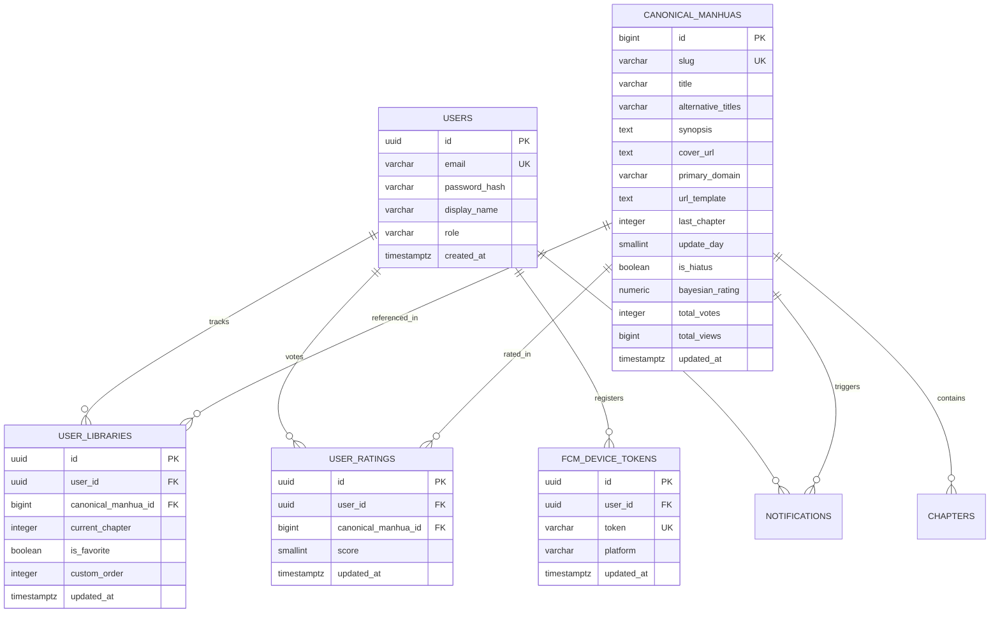
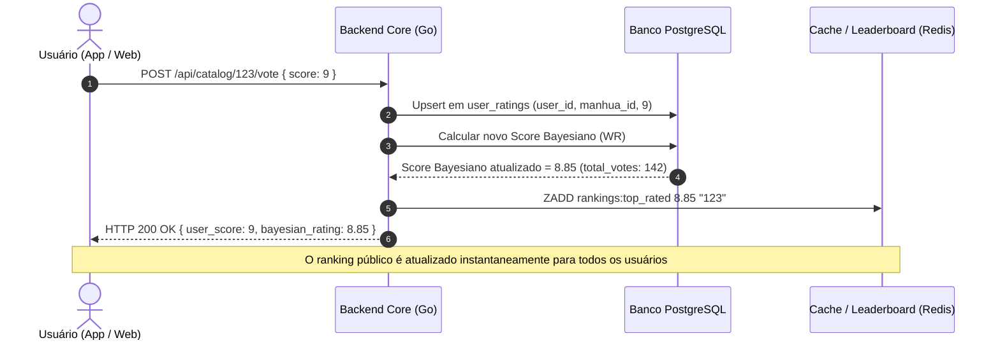

# Especificação Técnica de Requisitos e Engenharia — Manhua Manager Pro
**Versão:** 3.0.0-COMMERCIAL  
**Status:** Aprovado para Implementação  
**Data:** Outubro de 2026  
**Autor:** Thiago Oliveira & Equipe de Arquitetura de Software  
**Documentos Relacionados:** [PRD.md](PRD.md), [notes.md (Legado)](file:///home/thiagofdso/Projetos/manhua-manager/notes.md), [migracao-go.md (Legado)](file:///home/thiagofdso/Projetos/manhua-manager/migracao-go.md)  

---

## 1. Visão Geral da Arquitetura Comercial e Escopo

### 1.1 Objetivo do Sistema
Construir do zero uma plataforma escalável, segura e multi-tenant para a web e para a **Google Play Store**, preservando integralmente o arcabouço de regras de negócio de leitura e scraping consolidadas no protótipo original (`/Projetos/manhua-manager`), enquanto se introduzem os pilares de um produto comercial moderno:
1. **Controle Multi-Usuário com Separação Estrita de Bibliotecas:** Cada leitor possui sua biblioteca pessoal com progresso individual, favoritos, ordenação e histórico isolados.
2. **Catálogo Canônico Compartilhado:** Registro global de obras públicas com metadados unificados, sinopses, capas otimizadas em CDN e provedores de extração.
3. **Engajamento e Comunidade (Votação e Rankings):** Sistema de notas de 1 a 10 estrelas com pontuação Bayesiana e motor de rankings em tempo real no Redis (Mais Lidos Hoje/Semana/Geral, Mais Votados e Em Alta).
4. **Notificações Push Remotas (FCM):** Notificação instantânea na barra de status do celular Android quando novos capítulos de obras seguidas forem detectados.
5. **Conformidade Google Play Store:** Exclusão de conta in-app obrigatória, empacotamento em Android App Bundle (.aab), target SDK 34+ e segurança total contra SSRF e cleartext HTTP.

---

## 2. Catálogo Minucioso de Regras de Negócio Codificadas (V1 + Pro)

A análise do código-fonte legado e os novos requisitos comerciais consolidam o seguinte inventário de regras estritas que **DEVEM** ser implementadas:

### 2.1 Regra R-01: Decomposição e Resolução de Templates de URL
* **RN-01.1 (Detecção de Padrões de Capítulo):** Ao receber uma URL bruta de capítulo, o sistema detecta o número do episódio e o decompõe no template canônico contendo `{chapter}`:
  * `.../chapter-197/...` $\rightarrow$ `.../chapter-{chapter}/...`
  * `.../chapter/197/...` $\rightarrow$ `.../chapter/{chapter}/...`
  * `.../12345-chapter-197` $\rightarrow$ `.../{chapter}` (Comix)
  * Regex dinâmico: `(?<=[^0-9]|^)197(?=[^0-9]|$)` $\rightarrow$ `{chapter}`.
* **RN-01.2 (Resolução em Execução):** Para renderizar ou baixar um capítulo $N$, substitui-se `{chapter}` por $N$.
  * *Exceção Comix:* Se houver `chapterId` mapeado e o capítulo requisitado for o atual, a URL final torna-se `/{chapterId}-chapter-{chapter}`.
  * *Exceção MangaFire:* Se houver `chapterId` mapeado e o capítulo requisitado for o atual, o template substitui `{chapter}` pelo ID opaco interno da obra.

### 2.2 Regra R-02: Extratores Específicos por Provedor de Conteúdo

| Provedor / Domínio | Mecanismo de Extração de Imagens | Mecanismo de Navegação (Next/Prev) | Regras Específicas de Cabeçalhos e Proxy |
| :--- | :--- | :--- | :--- |
| **Asura Scans** (`asurascans.com`) | Varredura de tags `<astro-island>` e regex para imagens do CDN: `https://cdn.asurascans.com/asura-images/chapters(-merged)?/[^\s"'<>&]+`. Exclui capas, avatares e logos. | Regex HTML para `rel="next"`, `.next-post`, `.next_page`. | O proxy **DEVE** enviar `Referer: https://asurascans.com/`. |
| **MangaFire** (`mangafire.to`) | Extração em duas etapas: 1) Captura de `window.__config`, `window.__build` e script polyfill; 2) Geração de token VRF dinâmico via execução Node.js de `globalThis.dynamicEncrypt(path)`; 3) Consulta AJAX em `/ajax/read/{hid}/chapter/{id}` retornando URLs de imagens. | API AJAX retorna metadados com `next` e `prev` (objeto contendo `id`, `number`). | O proxy **DEVE** enviar `Referer: https://mangafire.to/`. |
| **Comix** (`comix.to`) | Execução de script Node.js com Puppeteer em ambiente virtual Xvfb (`comix_extractor.mjs`), aguardando carregamento do canvas dinâmico. | Extrator captura `id`, `number`, `next` e `prev` do objeto JSON de estado interno da página. | Não utiliza cabeçalho Referer no proxy (`referer = None`). |
| **ManhuaUS** (`manhuaus.com`) | Execução via script Node/Puppeteer com browser real (`manhuaus_extractor.mjs`), transpondo o desafio Cloudflare Turnstile e capturando o cookie de autorização `cf_clearance`. | Extração de navegação a partir do seletor do leitor. | O proxy **DEVE** enviar `Referer: https://manhuaus.com/`, `User-Agent` compatível e o cookie `Cookie: cf_clearance=<token>` armazenado em cache. |
| **RavenScans** (`ravenscans.org`) | 1) Busca de script inline contendo `ts_reader.run({ "sources": [{ "images": [...] }] })`; 2) Fallback para container `#readerarea img[data-src]`; 3) Exclusão estrita de `readerarea.svg`, logos e arquivos de tema WordPress. | Links HTML clássicos com classes de navegação. | O proxy **DEVE** enviar `Referer: https://ravenscans.org/`. |
| **MangaK** (`mangak.io`) | Decodificação do script de hidratação Next.js `<script id="__NEXT_DATA__">`, extraindo `props.pageProps.initialChapter.images`. Fallback regex para CDN `qvzr`. | Captura de `pageProps.nextChapter` e `previousChapter` do `__NEXT_DATA__`. | O proxy **DEVE** enviar `Referer: https://mangak.io/`. |
| **MGeko** (`mgeko.cc`) | Regex para ``, com fallback para `#chapter-reader img`. Filtra banners, logos e indicadores de loading. | Seletores HTML com classes `.nextchap`, `.next`, `.prevchap`. | Cabeçalhos HTTP padrão com `User-Agent` simulando browser desktop. |
| **ArenaScan** (`arenascan.com`) | Regex para imagens contendo `arena-bucket` ou `wp-content/uploads`, excluindo logos, avatares e ícones. | Links HTML padrão. | Cabeçalhos HTTP padrão. |
| **ManhuaTop** (`manhuatop.org`) | Regex para ``, excluindo explicitamente imagens contendo `about_manhuatop`. | Links HTML padrão. | Cabeçalhos HTTP padrão. |
| **Domínios Específicos** (`levelingwithgods.com`, `pickmeupgacha.com`, `magicemperor.online`) | Scrapers dedicados filtrando containers `.entry-content`, excluindo imagens com classes `lazy_placeholder` e domínios de propaganda. | Links de capítulos anteriores/posteriores da plataforma WordPress / Madara. | Cabeçalhos HTTP padrão. |

### 2.3 Regra R-03: Navegação, Metadados e Teto de Leitura
* **RN-03.1 (Avanço Linear vs Metadados de Provedor):**
  * Ao solicitar avançar (`delta: +1`) ou voltar (`delta: -1`):
    * Se o provedor retornar `nextChapter` (com número e ID) e `delta > 0`, o sistema atualiza `currentChapter` para o número indicado no metadado e atualiza `chapterId`.
    * Se o provedor retornar `prevChapter` e `delta < 0`, atualiza para o respectivo metadado.
    * Caso contrário, a nova posição é $\max(1, \text{currentChapter} + \text{delta})$.
* **RN-03.2 (Teto Inviolável por `lastChapter`):**
  * Se `lastChapter` estiver definido na obra:
    * Se $\text{currentChapter} \ge \text{lastChapter}$, o avanço de capítulo é estritamente bloqueado.
    * No aplicativo móvel da Play Store, o gesto de swipe para a direita é interceptado e cancelado com feedback visual.
    * Na web e mobile, o botão "Próximo" é desabilitado.
    * A inserção manual de um capítulo superior a `lastChapter` é rejeitada.
* **RN-03.3 (Promoção Automática de Leitura):**
  * Toda vez que um capítulo é lido ou atualizado (via `PATCH /api/library/<id>`), a obra do usuário é **automaticamente promovida ao topo de seu respectivo grupo** (favoritas ou não-favoritas), com `customOrder = min_order - 1` e `updatedAt = now()`.

### 2.4 Regra R-04: Sistema de Favoritos e Reordenação Inviolável
* **RN-04.1 (A Regra de Ouro dos Favoritos):**
  * Uma obra favorita (`isFavorite: true`) **NUNCA PODE** ser listada ou posicionada abaixo de qualquer obra não-favorita (`isFavorite: false`) na biblioteca do usuário.
  * A ordenação canônica de saída da biblioteca pessoal é:
    1. `isFavorite DESC` (true primeiro, false depois)
    2. `customOrder ASC` (valores menores têm precedência superior)
    3. `updatedAt DESC` (desempate favorecendo a obra manipulada mais recentemente)
* **RN-04.2 (Transição de Favorito):**
  * Ao favoritar (`isFavorite = true`), a obra recebe `customOrder = min_order(favoritas) - 1`, assumindo a liderança do grupo de favoritas.
  * Ao desfavoritar (`isFavorite = false`), a obra recebe `customOrder = min_order(não-favoritas) - 1`, assumindo a liderança do grupo de não-favoritas.
* **RN-04.3 (Validação e Correção de Reordenação Manual):**
  * O endpoint `PUT /api/library/reorder` recebe um vetor de IDs `[id_1, id_2, ..., id_N]`.
  * Se a ordem enviada colocar uma obra não-favorita antes de uma favorita, o backend reorganiza os itens agrupando todas as favoritas no topo antes das não-favoritas, preservando a ordem relativa desejada de cada subgrupo.

### 2.5 Regra R-05: Downloads em Lote e Leitura Offline Radical
* **RN-05.1 (Validação de Intervalo):**
  * Endpoint `/api/manhuas/<id>/batch-chapter-images?start=X&end=Y`:
    * $\text{start} \ge 1$ e $\text{end} \ge \text{start}$;
    * $(\text{end} - \text{start} + 1) \le 50$ (máximo de 50 capítulos por requisição);
    * Se `lastChapter` estiver definido: $\text{start} \le \text{lastChapter}$ e $\text{end} \le \text{lastChapter}$. Requisições além do limite retornam HTTP 400.
* **RN-05.2 (Tolerância a Falhas Parciais):**
  * O processamento dos capítulos do lote é concorrente no backend. Falhas em um capítulo individual não abortam os demais capítulos válidos do lote.
* **RN-05.3 (Leitor Offline-First Prioritário):**
  * Tanto na Web (IndexedDB) quanto no Mobile (FileSystem local), antes de disparar qualquer chamada de rede para `/api/chapter-images`, o leitor **DEVE** verificar a existência física do capítulo localmente. Existindo, carrega do disco em milissegundos sem requisições HTTP externas.
* **RN-05.4 (Política Rígida de Retenção — Sem Limpeza Automática):**
  * É expressamente **PROIBIDA** qualquer rotina de exclusão automática por tempo, limpeza de cache por LRU ou expiração programada. A exclusão é prerrogativa exclusiva do leitor.
* **RN-05.5 (Fila em Background e Cancelamento Atômico):**
  * O download ocorre em background desacoplado das telas ativas. O cancelamento interrompe a fila imediatamente e preserva com segurança os capítulos já 100% concluídos.

### 2.6 Regra R-06: Catálogo Canônico Global e Separação por Usuário
* **RN-06.1 (Entidade Canônica Global):**
  * As obras públicas residem na tabela `canonical_manhuas`. Cada registro possui ID único, título original, títulos alternativos, slug amigável, sinopse, capa otimizada em WebP, gêneros, status de publicação e template de URL da fonte primária.
* **RN-06.2 (Biblioteca Individual do Usuário):**
  * A tabela `user_libraries` vincula um `user_id` a um `canonical_manhua_id`.
  * Os campos `current_chapter`, `custom_order`, `is_favorite`, `notes` e `downloaded_chapters` pertencem exclusivamente ao usuário e não afetam outros membros da plataforma.

### 2.7 Regra R-07: Sistema de Votação e Média Ponderada Bayesiana
* **RN-07.1 (Voto Único por Usuário):**
  * Cada usuário autenticado pode registrar 1 voto de 1 a 5 estrelas por obra.
  * O usuário pode alterar seu voto a qualquer momento, atualizando o registro anterior sem duplicar votos na contagem geral.
* **RN-07.2 (Cálculo Bayesiano do Score Público):**
  * Para evitar que uma obra com apenas 1 voto de nota 5 assuma o topo do ranking, o score público ($WR$) é calculado pela fórmula da média ponderada Bayesiana (estilo IMDb / MyAnimeList) na escala de 1.00 a 5.00:
    $$WR = \frac{v}{v + m} \cdot R + \frac{m}{v + m} \cdot C$$
    Onde:
    * $R$: Média aritmética dos votos da obra (1.0 a 5.0);
    * $v$: Número de avaliações recebidas pela obra;
    * $m$: Número mínimo de votos exigido para figurar no ranking principal ($m = 10$);
    * $C$: Média global de todos os votos de todas as obras da plataforma (baseline prior $C = 3.5$).

### 2.8 Regra R-08: Rastreamento de Acessos e Motor de Rankings em Tempo Real (Redis)
* **RN-08.1 (Registro de Visualizações com Proteção contra Falsificação):**
  * Ao abrir um capítulo no leitor, o sistema emite evento de leitura anotando visualização (`view`).
  * O backend limita o incremento a no máximo 1 visualização por usuário/IP na mesma obra a cada 15 minutos (para prevenir inflação artificial de métricas).
* **RN-08.2 (Estrutura de Rankings no Redis):**
  * As visualizações são computadas atomicamente em Redis Sorted Sets:
    * `rankings:views:daily:{YYYY-MM-DD}` (Expiração automática após 48h)
    * `rankings:views:weekly:{YYYY-WW}` (Expiração automática após 14 dias)
    * `rankings:views:all_time` (Persistente)
    * `rankings:top_rated` (Ordenado pelo Score Bayesiano $WR$)
    * `rankings:most_popular` (Ordenado pelo total de usuários que possuem a obra na biblioteca)
  * As consultas de ranking executam em $\mathcal{O}(\log(N) + M)$ via `ZREVRANGEBYSCORE` ou `ZREVRANGE`, garantindo resposta instantânea ($\le 5\text{ ms}$) mesmo com centenas de milhares de acessos.
* **RN-08.3 (Padrão Híbrido de Consulta em Duas Etapas — Redis + Postgres):**
  * Para manter a resposta do ranking leve e rápida, o Redis armazena apenas `member: manhua_id` e `score: pontuação/views`.
  * Ao solicitar a listagem, o backend obtém o Top 20 IDs do Redis e executa uma consulta direta indexada por chave primária no PostgreSQL: `SELECT id, title, slug, cover_url FROM canonical_manhuas WHERE id IN (...)`.
* **RN-08.4 (Sincronização em Lote e Reconciliação / Warm-Up):**
  * Um worker em background em Go executa a cada 15 minutos consolidando as visualizações acumuladas no Redis e atualizando a coluna `total_views` na tabela `canonical_manhuas` do PostgreSQL.
  * Em caso de reinicialização ou falha na memória do Redis, uma rotina de *warm-up* na inicialização da API lê o banco PostgreSQL, recalcula os scores e repopula os Sorted Sets do Redis em poucos segundos.

### 2.9 Regra R-09: Notificações Push Remotas (FCM) para o Aplicativo Mobile
* **RN-09.1 (Registro de Token de Dispositivo):**
  * Ao fazer login no app móvel Flutter, o aplicativo captura o token do **Firebase Cloud Messaging (FCM)** e registra no backend (`POST /api/users/device-token`).
* **RN-09.2 (Disparo Automatizado na Rotina das 23:50):**
  * Ao detectar novo episódio de uma obra durante a varredura noturna, o backend localiza todos os usuários que possuem aquela obra em sua biblioteca pessoal e despacha mensagens push formatadas via FCM:
    * *Título:* `Novo Capítulo de {Título}`
    * *Corpo:* `O capítulo {N} já está disponível para leitura!`
    * *Data Payload:* `{"manhua_id": 123, "chapter": 245}` para abertura direta na tela de leitura.

### 2.10 Regra R-10: Conformidade Rigorosa com a Google Play Store
* **RN-10.1 (Exclusão Completa de Conta In-App — Obrigatório):**
  * Em conformidade com a exigência da Google Play Store (política de exclusão de dados do usuário), o aplicativo móvel **DEVE** conter opção visível nas configurações para exclusão imediata de conta (`DELETE /api/users/me`).
  * A exclusão apaga em cascata todos os dados pessoais do usuário (biblioteca pessoal, tokens de push, histórico de leitura e votos atribuídos).
* **RN-10.2 (Empacotamento e Assinatura):**
  * O app móvel é empacotado exclusivamente como **Android App Bundle (.aab)** compilado contra Target SDK 34+ (Android 14+).
  * Chaves de assinatura gerenciadas pelo **Google Play App Signing**.
* **RN-10.3 (Eliminação de Cleartext Traffic):**
  * Toda a comunicação externa opera sob TLS 1.3/HTTPS rigoroso. Não é permitida nenhuma conexão HTTP em texto puro.

---

## 3. Histórias de Usuário Atuais (Cobertura do Sistema V1)

As 12 histórias a seguir cobrem integralmente o comportamento validado no protótipo que foi preservado na nova arquitetura:

* **US-CURR-01:** Visualização da Biblioteca Pessoal Ordenada com Favoritos no Topo.
* **US-CURR-02:** Cadastro de Obra com Decomposição Automática de URL em `{chapter}`.
* **US-CURR-03:** Leitura Contínua Vertical (Webtoon Continuous Stream).
* **US-CURR-04:** Avanço e Recuo de Capítulos com Bloqueio de Último Episódio (`lastChapter`).
* **US-CURR-05:** Favoritar e Reordenar Obras com Separação Estrita de Grupos.
* **US-CURR-06:** Download de Capítulos em Lote por Intervalo (Máximo 50 capítulos).
* **US-CURR-07:** Fila de Download em Segundo Plano com Cancelamento Sob Demanda.
* **US-CURR-08:** Leitura Prioritária 100% Offline (Verificação Local Antes da Rede).
* **US-CURR-09:** Verificação Noturna de Lançamentos às 23:50 com Agendador Idempotente.
* **US-CURR-10:** Central Unificada de Notificações com Descarte Seguro ao Visualizar.
* **US-CURR-11:** Importação de Obras via Catálogo Multi-Domínio com Cache de 7 Dias.
* **US-CURR-12:** Catálogo Agregado Multi-Cache ("Todos" — `all`) com Desduplicação por URL.

---

## 4. Histórias de Usuário Comerciais e para Google Play Store (US-PRO)

### Módulo 1: Comunidade, Votações e Rankings

#### US-PRO-COMM-01: Avaliação de Obras com Sistema de 1 a 10 Estrelas
* **Como** leitor registrado,  
* **Quero** atribuir uma nota de 1 a 10 estrelas para uma obra que estou lendo,  
* **Para que** eu possa expressar minha opinião e ajudar a ranquear os melhores títulos da plataforma.  
* **Critérios de Aceitação (Gherkin):**
  ```gherkin
  Cenário: Atribuição de voto com sucesso
    Dado que estou autenticado na plataforma
    E estou visualizando a página da obra "Solo Leveling"
    Quando eu seleciono a nota 9 e confirmo o voto
    Então o sistema registra meu voto no banco de dados
    E o score ponderado Bayesiano da obra é recalculado imediatamente
    E vejo a minha nota destacada na interface
  ```

#### US-PRO-COMM-02: Consulta aos Rankings em Tempo Real (Mais Lidos e Melhor Votados)
* **Como** usuário explorando o aplicativo,  
* **Quero** acessar a tela de Rankings com abas de "Mais Lidos Hoje", "Mais Lidos na Semana", "Top Geral" e "Melhor Votados",  
* **Para que** eu descubra rapidamente quais manhuas estão em alta na comunidade.  
* **Critérios de Aceitação (Gherkin):**
  ```gherkin
  Cenário: Exibição do ranking de mais lidos da semana
    Dado que abro a aba "Rankings" no app móvel ou web
    Quando seleciono o filtro "Mais Lidos na Semana"
    Então o sistema retorna a lista ordenada obtida do Redis em tempo real
    E cada card exibe a posição no ranking (1º, 2º, 3º...), capa, título, score médio e volume de acessos
  ```

#### US-PRO-COMM-03: Rastreamento Automático de Visualizações e Métricas
* **Como** administrador da plataforma,  
* **Quero** que cada leitura de capítulo incremente os contadores de visualização de forma segura e sem duplicidades abusivas,  
* **Para que** os rankings reflitam o engajamento real e orgânico da comunidade.  
* **Critérios de Aceitação (Gherkin):**
  ```gherkin
  Cenário: Incremento de visualização com rate limit por usuário
    Dado que um usuário autenticado abre o capítulo 15 de uma obra
    Quando a requisição de leitura é processada
    Então o contador de visualizações diárias da obra no Redis é incrementado em 1 via ZINCRBY
    E uma nova abertura da mesma obra pelo mesmo usuário nos próximos 15 minutos não duplica o contador
  ```

#### US-PRO-COMM-04: Adição Direta do Ranking para a Biblioteca Pessoal
* **Como** leitor,  
* **Quero** clicar em "+ Minha Biblioteca" diretamente no card de um ranking,  
* **Para que** eu comece a acompanhar a obra imediatamente sem etapas manuais de cadastro.  
* **Critérios de Aceitação (Gherkin):**
  ```gherkin
  Cenário: Adicionar obra a partir do ranking
    Dado que estou visualizando o Top 10 semanal
    Quando clico no botão "+ Biblioteca" na obra "Overgeared"
    Então o sistema cria um registro na minha tabela user_libraries com currentChapter=1 e isFavorite=false
    E o botão muda para "Seguindo / Na Biblioteca"
  ```

---

### Módulo 2: Autenticação, Multi-Tenancy e Google Play Store

#### US-PRO-PLAY-01: Cadastro, Login e Autenticação Google Unificada (Web & Play Store)
* **Como** usuário da plataforma na Web ou no Android,  
* **Quero** efetuar login com 1 clique utilizando minha conta Google ou cadastrar e-mail/senha,  
* **Para que** minha biblioteca, histórico e preferências fiquem instantaneamente sincronizados em todos os dispositivos sem esforço.  
* **Critérios de Aceitação:**
  * **Flutter (Android Play Store):** Utiliza o SDK nativo do Google Sign-In / Credential Manager, capturando o `id_token` do Google assinado.
  * **Angular (Web):** Utiliza Google Identity Services (GIS / Google One Tap), capturando o mesmo formato de `id_token`.
  * **Backend Core (Go):** Rota unificada `POST /api/auth/google`:
    * Valida o `id_token` do Google cryptograficamente contra as chaves públicas oficiais do Google (`https://www.googleapis.com/oauth2/v3/certs`).
    * Extrai `sub` (Google User ID único e imutável), `email`, `name` e `picture`.
    * Localiza ou cria o usuário na tabela `users` (com `auth_provider = 'google'` e `google_id`).
    * Emite o par canônico da plataforma: Access Token JWT (15 min) e Refresh Token (30 dias).
  * Endpoint `POST /api/auth/register` e `POST /api/auth/login` preservados como alternativa para usuários que preferirem e-mail/senha tradicional com hash **Argon2id**.

#### US-PRO-PLAY-02: Exclusão Completa de Conta e Dados In-App (Mandatório Google Play)
* **Como** usuário do aplicativo mobile,  
* **Quero** poder excluir permanentemente minha conta e todos os meus dados diretamente pelas configurações do app,  
* **Para que** meus dados pessoais sejam removidos em conformidade com as políticas do Google Play e LGPD/GDPR.  
* **Critérios de Aceitação:**
  * Opção visível nas configurações: "Excluir Minha Conta".
  * Confirmação mediante digitação de senha ou código de confirmação.
  * Disparo de `DELETE /api/users/me` que apaga em cascata: biblioteca pessoal, tokens FCM, histórico e avaliações.

#### US-PRO-PLAY-03: Notificações Push Remotas via Firebase Cloud Messaging (FCM)
* **Como** usuário mobile,  
* **Quero** receber notificações push na barra de status do Android quando sair novo capítulo de uma obra que sigo,  
* **Para que** eu seja informado mesmo se o aplicativo estiver fechado.  
* **Critérios de Aceitação:**
  * Ao abrir o app Flutter, o token FCM do dispositivo é registrado no backend.
  * O worker de rotina das 23:50 dispara mensagens FCM direcionadas aos usuários inscritos nas obras atualizadas.
  * Tocar na notificação abre o app diretamente no leitor do novo capítulo.

#### US-PRO-PLAY-04: Empacotamento Android App Bundle (.aab) e Release Signing
* **Como** desenvolvedor do app,  
* **Quero** gerar o pacote oficial `.aab` assinado via GitHub Actions com keystore de produção,  
* **Para que** a publicação na Google Play Console ocorra de forma automatizada e sem advertências.  
* **Critérios de Aceitação:**
  * Compilação com `flutter build appbundle --release`.
  * Configuração segura de `key.properties` via segredos do GitHub (Base64 Keystore).
  * Target SDK 34+ e conformidade total com políticas de 64-bit do Google.

---

### Módulo 3: Backend de Alta Performance em Go e Streaming Seguro

#### US-PRO-CORE-01: Streaming de Imagens com Zero-Buffer e Proteção Anti-SSRF
* **Como** engenheiro de infraestrutura,  
* **Quero** que o proxy de imagens entregue chunks diretamente ao cliente via streaming e bloqueie IPs privados,  
* **Para que** o servidor economize memória RAM e fique blindado contra ataques de rede interna.  
* **Critérios de Aceitação:**
  * O gateway Go utiliza `io.Copy` em blocos de 32 KB sem manter o arquivo completo em RAM.
  * Validação prévia de DNS da URL requisitada: bloqueia ativamente conexões para `127.0.0.1`, RFC 1918 (`10.0.0.0/8`, `172.16.0.0/12`, `192.168.0.0/16`) e metadados de nuvem (`169.254.169.254`).
  * Headers customizados por domínio (Referer para AsuraScans/MangaFire, cookies de sessão para ManhuaUS).

#### US-PRO-CORE-02: Cache de Capas em Object Storage (Cloudflare R2 / S3)
* **Como** arquiteto de sistemas,  
* **Quero** que as capas das obras canônicas sejam cacheadas em um bucket próprio e servidas por CDN,  
* **Para que** os rankings e catálogos carreguem instantaneamente sem depender da disponibilidade dos sites parceiros.  
* **Critérios de Aceitação:**
  * Ao cadastrar uma obra canônica, a capa é baixada, convertida para WebP otimizado e salva no bucket R2/S3.
  * A URL pública da capa na CDN é gravada no banco e servida aos clientes web e mobile.

---

### Módulo 4: Containerização, Docker e Orquestração Cloud-Native

#### US-PRO-DOCK-01: Containerização Multi-Estágio com Imagens Imutáveis e Distroless
* **Como** engenheiro de DevOps / SRE,  
* **Quero** que o backend Go, os workers Node.js e o frontend Angular sejam compilados em Dockerfiles multi-estágio seguros e leves,  
* **Para que** a implantação seja determinística, reprodutível e livre de ferramentas de desenvolvimento em produção.  
* **Critérios de Aceitação:**
  * **Go Core:** Imagem compilada estaticamente com Go 1.23, estágio final utilizando `gcr.io/distroless/static-debian12:nonroot` gerando imagem final inferior a **25 MB**.
  * **Workers Node.js:** Estágio final baseado em Debian-slim com bibliotecas de Chromium/Puppeteer, gerenciador de processos `dumb-init` (para expurgo de processos zumbis de navegadores) e usuário sem privilégios `pptruser`.
  * **Angular Web Client:** Build de produção compilado em Node 20 e servido por contêiner ultra-leve `nginx:alpine` com compactação gzip/brotli e headers de segurança HTTP.

#### US-PRO-DOCK-02: Orquestração Unificada com Docker Compose (Dev e Produção)
* **Como** desenvolvedor da equipe,  
* **Quero** iniciar todo o ecossistema (PostgreSQL, Redis, Go Core, Workers Node e Web Angular) com um único comando,  
* **Para que** o onboarding de desenvolvedores e a implantação em servidores de produção sejam automatizados e padronizados.  
* **Critérios de Aceitação:**
  * `deployments/docker-compose.yml`: Ambiente de desenvolvimento com montagem de volumes para hot-reload e portas mapeadas.
  * `deployments/docker-compose.prod.yml`: Configuração de produção com health checks contínuos (`test: ["CMD", "/healthz"]`), limites estritos de CPU/memória por contêiner, isolamento em redes internas (`backend-net`, `frontend-net`), políticas de reinício `restart: unless-stopped` e volumes persistentes nomeados para o PostgreSQL e Redis.

---

## 5. Esquema de Banco de Dados Relacional (PostgreSQL 16+)

A arquitetura comercial utiliza **PostgreSQL 16** com suporte a JSONB e chaves estrangeiras com exclusão em cascata:



### 5.1 Script DDL (PostgreSQL)

```sql
CREATE EXTENSION IF NOT EXISTS "uuid-ossp";

-- 1. Tabela de Usuários Multi-Tenant (Suporte a E-mail/Senha e Google OAuth)
CREATE TABLE IF NOT EXISTS users (
    id UUID PRIMARY KEY DEFAULT gen_random_uuid(),
    email VARCHAR(255) NOT NULL UNIQUE,
    password_hash VARCHAR(255) NULL, -- Nulo para contas autenticadas exclusivamente via Google OAuth
    google_id VARCHAR(128) NULL UNIQUE, -- Identificador único imutável do Google (sub)
    display_name VARCHAR(100) NOT NULL,
    avatar_url TEXT NULL,
    auth_provider VARCHAR(32) NOT NULL DEFAULT 'email', -- 'email', 'google'
    role VARCHAR(32) NOT NULL DEFAULT 'reader', -- 'admin', 'reader'
    created_at TIMESTAMPTZ NOT NULL DEFAULT CURRENT_TIMESTAMP,
    updated_at TIMESTAMPTZ NOT NULL DEFAULT CURRENT_TIMESTAMP
);

-- 2. Tabela de Obras Canônicas (Catálogo Global Compartilhado)
CREATE TABLE IF NOT EXISTS canonical_manhuas (
    id BIGINT PRIMARY KEY, -- Compatibilidade com IDs numéricos legados
    slug VARCHAR(255) NOT NULL UNIQUE,
    title VARCHAR(255) NOT NULL,
    alternative_titles TEXT NULL,
    synopsis TEXT NULL,
    cover_url TEXT NULL, -- URL na CDN/R2
    primary_domain VARCHAR(64) NOT NULL,
    url_template TEXT NOT NULL,
    last_chapter INTEGER NULL,
    update_day SMALLINT NULL, -- 0 (Segunda) a 6 (Domingo)
    is_hiatus BOOLEAN NOT NULL DEFAULT FALSE,
    bayesian_rating NUMERIC(4, 2) NOT NULL DEFAULT 0.00,
    total_votes INTEGER NOT NULL DEFAULT 0,
    total_views BIGINT NOT NULL DEFAULT 0,
    created_at TIMESTAMPTZ NOT NULL DEFAULT CURRENT_TIMESTAMP,
    updated_at TIMESTAMPTZ NOT NULL DEFAULT CURRENT_TIMESTAMP
);

CREATE INDEX IF NOT EXISTS idx_canonical_ranking_views ON canonical_manhuas (total_views DESC);
CREATE INDEX IF NOT EXISTS idx_canonical_ranking_rating ON canonical_manhuas (bayesian_rating DESC, total_votes DESC);
CREATE INDEX IF NOT EXISTS idx_canonical_routine_check ON canonical_manhuas (update_day, is_hiatus, last_chapter) WHERE is_hiatus = FALSE;

-- 3. Biblioteca Pessoal do Usuário (Multi-Tenant Isolado)
CREATE TABLE IF NOT EXISTS user_libraries (
    id UUID PRIMARY KEY DEFAULT gen_random_uuid(),
    user_id UUID NOT NULL REFERENCES users(id) ON DELETE CASCADE,
    canonical_manhua_id BIGINT NOT NULL REFERENCES canonical_manhuas(id) ON DELETE CASCADE,
    current_chapter INTEGER NOT NULL DEFAULT 1,
    is_favorite BOOLEAN NOT NULL DEFAULT FALSE,
    custom_order INTEGER NOT NULL DEFAULT 0,
    created_at TIMESTAMPTZ NOT NULL DEFAULT CURRENT_TIMESTAMP,
    updated_at BIGINT NOT NULL, -- Timestamp epoch em segundos para ordenação canônica
    CONSTRAINT uq_user_manhua UNIQUE (user_id, canonical_manhua_id)
);

-- Índice ultra-otimizado para a Regra de Ouro (RN-04)
CREATE INDEX IF NOT EXISTS idx_user_library_sort 
ON user_libraries (user_id, is_favorite DESC, custom_order ASC, updated_at DESC);

-- 4. Avaliações Comunitárias (Rating de 1 a 10)
CREATE TABLE IF NOT EXISTS user_ratings (
    id UUID PRIMARY KEY DEFAULT gen_random_uuid(),
    user_id UUID NOT NULL REFERENCES users(id) ON DELETE CASCADE,
    canonical_manhua_id BIGINT NOT NULL REFERENCES canonical_manhuas(id) ON DELETE CASCADE,
    score SMALLINT NOT NULL CHECK (score >= 1 AND score <= 10),
    created_at TIMESTAMPTZ NOT NULL DEFAULT CURRENT_TIMESTAMP,
    updated_at TIMESTAMPTZ NOT NULL DEFAULT CURRENT_TIMESTAMP,
    CONSTRAINT uq_user_rating UNIQUE (user_id, canonical_manhua_id)
);

-- 5. Registro de Tokens FCM para Push Notifications
CREATE TABLE IF NOT EXISTS fcm_device_tokens (
    id UUID PRIMARY KEY DEFAULT gen_random_uuid(),
    user_id UUID NOT NULL REFERENCES users(id) ON DELETE CASCADE,
    token VARCHAR(512) NOT NULL UNIQUE,
    platform VARCHAR(32) NOT NULL DEFAULT 'android', -- 'android', 'ios', 'web'
    updated_at TIMESTAMPTZ NOT NULL DEFAULT CURRENT_TIMESTAMP
);
```

---

## 6. Especificação da API RESTful Comercial (OpenAPI 3.1)

### 6.1 Módulo de Autenticação e Conta (`/api/auth` e `/api/users`)
* `POST /api/auth/register`: Cadastro tradicional de usuário (`email`, `password`, `displayName`).
* `POST /api/auth/login`: Autenticação e-mail/senha retornando JWT e Refresh Token.
* `POST /api/auth/google`: Autenticação unificada com Google (Web & Android Play Store) recebendo `{ "idToken": "..." }`, validando criptograficamente contra chaves do Google e retornando JWT da plataforma.
* `POST /api/auth/refresh`: Renovação do access token via refresh token HttpOnly.
* `DELETE /api/users/me`: **(Mandatório Google Play)** Exclusão definitiva da conta e dados do usuário.
* `POST /api/users/device-token`: Cadastro do token FCM do celular para push notifications.

### 6.2 Módulo de Catálogo Global e Comunidade (`/api/catalog`, `/api/rankings`)
* `GET /api/catalog`: Listagem e busca paginada no catálogo global de obras.
* `GET /api/catalog/{slug}`: Detalhes completos da obra, score médio, número de votos e sinopse.
* `POST /api/catalog/{id}/vote`: Registra voto do usuário autenticado (`score`: 1..10) com recálculo Bayesiano.
* `GET /api/rankings/views?period={daily|weekly|all_time}`: Retorna o ranking em tempo real dos mais lidos via Redis ZSET.
* `GET /api/rankings/top-rated`: Retorna o ranking dos títulos com melhor avaliação ponderada.

### 6.3 Módulo da Biblioteca Pessoal do Usuário (`/api/library`)
* `GET /api/library`: Retorna as obras seguidas pelo usuário autenticado, estritamente ordenadas pela Regra de Ouro: `(isFavorite DESC, customOrder ASC, updatedAt DESC)`.
* `POST /api/library`: Adiciona uma obra do catálogo à biblioteca pessoal.
* `PATCH /api/library/{id}`: Atualiza capítulo (`chapter` ou `delta`), alterna favorito (`isFavorite`) com promoção automática ao topo do grupo.
* `PUT /api/library/reorder`: Reordenação manual com autocorreção garantindo favoritos no topo.
* `DELETE /api/library/{id}`: Remove a obra da biblioteca pessoal do usuário.

### 6.4 Módulo de Leitura e Proxy Streaming (`/api/reader`)
* `GET /api/reader/chapter-images?url={target_url}`: Extração das páginas do capítulo.
* `GET /api/reader/batch?canonical_id={id}&start={X}&end={Y}`: Extração em lote para download (máx 50 capítulos).
* `GET /api/reader/proxy-image?url={img_url}`: Proxy de streaming direto (`io.Copy`), proteção anti-SSRF e cache de cabeçalhos.

---

## 7. Diagramas de Sequência e Arquitetura

### 7.1 Fluxo de Votação Comunitária e Atualização de Leaderboard



### 7.2 Arquitetura de Nuvem e Deploy Multi-Tenant

```mermaid
flowchart TD
    subgraph CDNLayer["Borda & Distribuição Global (Cloudflare)"]
        DNS["Cloudflare DNS & WAF"]
        R2["Cloudflare R2 Bucket\n[Capas WebP Otimizadas]"]
    end

    subgraph AppCluster["Cluster de Aplicação (Nuvem / Kubernetes / Docker)"]
        Gateway["Go Core API Gateway\n[Port 8080 - REST / Proxy Streaming]"]
        WorkerPool["Node.js Headless Scraping Pool\n[Puppeteer / Turnstile Bypass]"]
        Scheduler["Asynq Scheduler Daemon\n[23:50 Cron / FCM Push Service]"]
    end

    subgraph DataCluster["Camada de Dados Gerenciada"]
        Postgres[(PostgreSQL 16 Cluster)]
        Redis[(Redis 7 Cluster\n[ZSET Leaderboards / Cache])]
    end

    subgraph MobileServices["Google Play Services"]
        FCM["Firebase Cloud Messaging (FCM)"]
        PlayConsole["Google Play Store"]
    end

    Users[Usuários Mobile & Web] --> DNS
    DNS --> Gateway
    DNS --> R2
    Gateway --> Postgres
    Gateway --> Redis
    Gateway --> R2
    Gateway --> WorkerPool
    Scheduler --> Postgres
    Scheduler --> Redis
    Scheduler -->|Disparo de Push| FCM
    FCM -->|Push Notification| Users
    PlayConsole -->|Distribuição de App .aab| Users
```

---

## 8. Arquitetura de Containerização e Orquestração Docker

Todo o ecossistema de backend, scraping e frontend web do **Manhua Manager Pro** é estritamente containerizado para garantir paridade total entre os ambientes de desenvolvimento, homologação e produção em nuvem.

### 8.1 Especificação dos Dockerfiles Multi-Estágio

#### 1. Backend Core & Streaming Proxy (`apps/api-gateway/Dockerfile`)
```dockerfile
# Estágio 1: Build da Aplicação em Go
FROM golang:1.23-alpine AS builder
WORKDIR /app
RUN apk add --no-cache git ca-certificates tzdata
COPY go.mod go.sum ./
RUN go mod download
COPY . .
RUN CGO_ENABLED=0 GOOS=linux GOARCH=amd64 go build \
    -ldflags="-w -s -X main.version=3.0.0-PRO" \
    -o /bin/manhua-api ./cmd/server

# Estágio 2: Imagem Final Distroless Segura e Leve (< 25 MB)
FROM gcr.io/distroless/static-debian12:nonroot
WORKDIR /
COPY --from=builder /bin/manhua-api /manhua-api
COPY --from=builder /etc/ssl/certs/ca-certificates.crt /etc/ssl/certs/
COPY --from=builder /usr/share/zoneinfo /usr/share/zoneinfo
EXPOSE 8080
USER nonroot:nonroot
ENTRYPOINT ["/manhua-api"]
```

#### 2. Scraping Worker Pool (`apps/scraping-workers/Dockerfile`)
```dockerfile
# Estágio 1: Imagem Base com Chromium e Dependências do Puppeteer
FROM node:20-slim AS runner
WORKDIR /app
RUN apt-get update && apt-get install -y --no-install-recommends \
    chromium \
    xvfb \
    dumb-init \
    fonts-liberation \
    libnss3 \
    libxss1 \
    libasound2 \
    && rm -rf /var/lib/apt/lists/*

ENV PUPPETEER_SKIP_CHROMIUM_DOWNLOAD=true \
    PUPPETEER_EXECUTABLE_PATH=/usr/bin/chromium \
    NODE_ENV=production

COPY package*.json ./
RUN npm ci --only=production
COPY . .
RUN groupadd -r pptruser && useradd -r -g pptruser -G audio,video pptruser \
    && mkdir -p /home/pptruser/Downloads /app/.cache \
    && chown -R pptruser:pptruser /home/pptruser /app

USER pptruser
EXPOSE 50051
ENTRYPOINT ["/usr/bin/dumb-init", "--"]
CMD ["node", "dist/server.js"]
```

#### 3. Frontend Web SPA Angular (`apps/web-client/Dockerfile`)
```dockerfile
# Estágio 1: Build do Angular 18+
FROM node:20-alpine AS builder
WORKDIR /app
COPY package*.json ./
RUN npm ci
COPY . .
RUN npm run build -- --configuration=production

# Estágio 2: Servidor Nginx Otimizado com Compressão e Roteamento SPA
FROM nginx:alpine
COPY --from=builder /app/dist/web-client/browser /usr/share/nginx/html
COPY deployments/nginx/nginx.conf /etc/nginx/conf.d/default.conf
EXPOSE 80
HEALTHCHECK --interval=30s --timeout=3s --retries=3 \
  CMD wget -q -O /dev/null http://localhost/ || exit 1
CMD ["nginx", "-g", "daemon off;"]
```

---

### 8.2 Orquestração com Docker Compose

#### Ambiente de Desenvolvimento (`deployments/docker-compose.yml`)
Permite aos desenvolvedores subir todo o stack com 1 comando, montando volumes para hot-reload:
* PostgreSQL 16 (porta 5432) com extensão UUID habilitada.
* Redis 7 (porta 6379) para leaderboards e cache de visualizações.
* Backend Go com `air` para live-reloading.
* Scraping Worker Pool Node com `ts-node-dev`.
* Angular Web Client rodando com `ng serve` na porta 4200.

#### Ambiente de Produção Cloud-Native (`deployments/docker-compose.prod.yml`)
```yaml
version: '3.9'

networks:
  public_net:
    driver: bridge
  internal_net:
    internal: true

volumes:
  pg_data:
  redis_data:

services:
  postgres:
    image: postgres:16-alpine
    restart: unless-stopped
    environment:
      POSTGRES_DB: manhua_pro
      POSTGRES_USER: ${DB_USER:-manhua_user}
      POSTGRES_PASSWORD: ${DB_PASSWORD}
    volumes:
      - pg_data:/var/lib/postgresql/data
    networks:
      - internal_net
    deploy:
      resources:
        limits:
          cpus: '2.0'
          memory: 2048M
    healthcheck:
      test: ["CMD-SHELL", "pg_isready -U ${DB_USER:-manhua_user} -d manhua_pro"]
      interval: 10s
      timeout: 5s
      retries: 5

  redis:
    image: redis:7-alpine
    restart: unless-stopped
    command: ["redis-server", "--appendonly", "yes", "--requirepass", "${REDIS_PASSWORD}"]
    volumes:
      - redis_data:/data
    networks:
      - internal_net
    deploy:
      resources:
        limits:
          cpus: '1.0'
          memory: 512M
    healthcheck:
      test: ["CMD", "redis-cli", "ping"]
      interval: 10s
      timeout: 3s
      retries: 3

  api-gateway:
    build:
      context: ../apps/api-gateway
      dockerfile: Dockerfile
    restart: unless-stopped
    environment:
      PORT: 8080
      DATABASE_URL: postgres://${DB_USER:-manhua_user}:${DB_PASSWORD}@postgres:5432/manhua_pro?sslmode=disable
      REDIS_URL: redis://:${REDIS_PASSWORD}@redis:6379/0
      JWT_SECRET: ${JWT_SECRET}
      R2_BUCKET_NAME: ${R2_BUCKET_NAME}
      R2_ACCESS_KEY_ID: ${R2_ACCESS_KEY_ID}
      R2_SECRET_ACCESS_KEY: ${R2_SECRET_ACCESS_KEY}
      SCRAPER_WORKER_URL: scraping-workers:50051
    depends_on:
      postgres:
        condition: service_healthy
      redis:
        condition: service_healthy
    networks:
      - internal_net
      - public_net
    deploy:
      resources:
        limits:
          cpus: '2.0'
          memory: 1024M
    healthcheck:
      test: ["CMD", "/manhua-api", "-healthcheck"]
      interval: 15s
      timeout: 3s
      retries: 3

  scraping-workers:
    build:
      context: ../apps/scraping-workers
      dockerfile: Dockerfile
    restart: unless-stopped
    environment:
      PORT: 50051
      MAX_CONCURRENT_BROWSERS: 5
    networks:
      - internal_net
    deploy:
      resources:
        limits:
          cpus: '3.0'
          memory: 3072M

  web-client:
    build:
      context: ../apps/web-client
      dockerfile: Dockerfile
    restart: unless-stopped
    ports:
      - "80:80"
      - "443:443"
    depends_on:
      - api-gateway
    networks:
      - public_net
    deploy:
      resources:
        limits:
          cpus: '1.0'
          memory: 512M
```

---

## 9. Esteira de CI/CD para Google Play Store, Web e Imagens Docker (`.github/workflows`)

### 9.1 Pipeline de Build de Contêineres Multi-Arch (`build-docker.yml`)
1. **Trigger:** Push na branch `main` ou tags `v*.*.*`.
2. **Setup:** Docker Buildx com emulação QEMU (`linux/amd64`, `linux/arm64`).
3. **Build e Push:**
   * Build e publicação das imagens `manhua-api`, `manhua-scraping-workers` e `manhua-web` no **GitHub Container Registry (ghcr.io)**.
   * Utilização do cache de camadas do GitHub Actions (`type=gha`) para builds incrementais rápidos (< 2 minutos).
   * Varredura automatizada de vulnerabilidades em contêineres com **Trivy**.

### 9.2 Pipeline de Build e Publicação Mobile (`release-mobile.yml`)
1. **Trigger:** Criação de tag semântica `v*.*.*` no GitHub.
2. **Ambiente:** Ubuntu runner com Java 17 e Flutter SDK estável.
3. **Assinatura de Release:**
   * Decodificação da chave de produção via GitHub Secrets (`RELEASE_KEYSTORE_BASE64`).
   * Configuração das credenciais em `android/key.properties`.
4. **Compilação do Pacote:**
   * Execução de `flutter build appbundle --release --build-number=$GITHUB_RUN_NUMBER`.
5. **Publicação Automatizada na Play Store:**
   * Utilização da action `r0adkll/upload-google-play` com chave de serviço da Google Play Console.
   * Publicação direta na track **Internal Testing** ou **Closed Beta** para testes de homologação.

---

## 10. Próximos Passos de Execução Técnica

1. **Configuração Inicial do Monorepo e Docker Compose:** Criar a estrutura base de pastas e os arquivos `deployments/docker-compose.yml` e `deployments/docker-compose.prod.yml`.
2. **Implementação do Banco PostgreSQL e Redis:** Configurar migrações das tabelas de catálogo canônico, bibliotecas, avaliações e índices de ranking.
3. **Desenvolvimento do Core em Go no Docker:** Construir a API REST e o proxy de streaming seguro de imagens em contêiner distroless.
4. **Construção do Worker Pool Node.js:** Empacotar o serviço Puppeteer com Chromium em contêiner Debian-slim com `dumb-init`.
5. **Frontend Angular e Integração Mobile Flutter:** Desenvolver a SPA Angular e preparar o pacote `.aab` do Flutter com Firebase Cloud Messaging.
